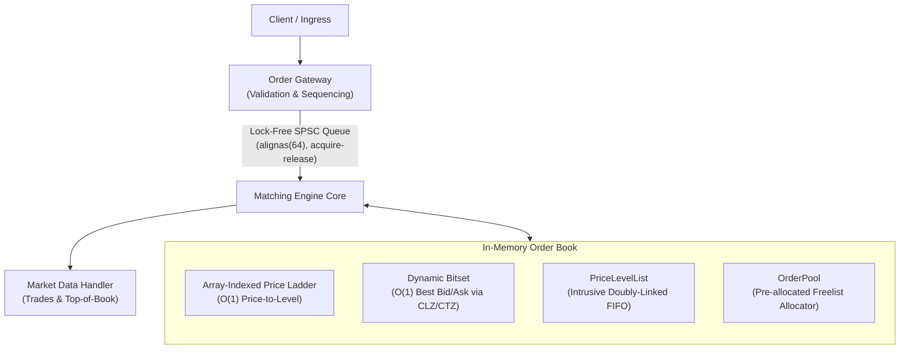

# LatencyX — Low-Latency Limit Order Book & Matching Engine

A deterministic, high-throughput limit order book (LOB) matching engine written in C++20.
Designed with mechanical sympathy: cache-line alignment, zero heap allocations on the hot path,
O(1) price-level operations, and lock-free thread boundaries.



---

## Attribution

This project is based on the original **LatencyX** matching engine. The core engine,
data structures, tests, and CMake/build infrastructure were inherited from that codebase.

**My contributions** are limited to:
- Benchmark methodology audit (`benchmarks/` directory) — identifying defects in six of the
  thirteen benchmark cases.
- Correcting `BM_MatchingEngine_Throughput` in `benchmarks/bench_matching.cpp` to exclude
  engine construction and destruction from the measured window using
  `state.PauseTiming()` / `state.ResumeTiming()` and `std::optional<MatchingEngine>`.
- Adding `bench_baseline_m2.txt` and `bench_baseline_m2_corrected.txt` — raw benchmark
  output captured on an Apple M2 before and after the fix, as reproducibility evidence.
- Minor `.gitignore` additions (`.DS_Store`, `.kiro/`).
- This README update.

No production source files (`src/`, `include/`), tests (`tests/`), or build configuration
(`CMakeLists.txt`, `build.sh`) were modified.

---

## Core Design

- **Zero-Allocation Hot Path:** Pre-allocated `OrderPool` with an intrusive freelist allocator
  avoids `new`/`delete`/`malloc` during order processing.
- **O(1) Level Indexing:** Direct array-indexed `PriceLadder` provides constant-time access to
  price levels without tree traversals.
- **O(1) Top-of-Book Discovery:** Word-level `DynamicBitset` locates best bid/ask in constant
  time using CPU bit-scanning intrinsics (`__builtin_clzll` / `__builtin_ctzll`).
- **O(1) FIFO & Cancellation:** Intrusive doubly-linked lists embedded in `Order` structs allow
  O(1) removal on cancellation without node lookup or allocation.
- **Lock-Free Pipeline:** Cache-line-aligned (`alignas(64)`) SPSC ring buffer synchronises
  ingress and matching threads with acquire-release memory semantics.
- **Differential Verification:** Randomised fuzz testing against a naive `std::map` reference
  engine verifies invariant preservation, trade correctness, and execution reports.

---

## Build & Test

### Requirements

| Tool | Minimum version |
|---|---|
| C++ compiler | C++20 (Apple Clang 14+ or GCC 12+) |
| CMake | 3.20 |
| Git | any recent version |
| Internet access | required on first build (FetchContent downloads googletest v1.14.0 and googlebenchmark v1.8.3) |

### Quick Start (CMake — works on macOS Apple Silicon and Linux x86_64)

```bash
mkdir -p build && cd build
cmake .. -DCMAKE_BUILD_TYPE=Release
make -j$(sysctl -n hw.ncpu 2>/dev/null || nproc)   # macOS: sysctl; Linux: nproc

# Run all 65 unit and differential tests
./matching_tests

# Run benchmarks
./matching_bench
```

### Alternative: build.sh

```bash
./build.sh
./build/matching_tests
./build/matching_bench
```

> **macOS note:** `build.sh` uses `$(nproc)` which is Linux-only. The CMake path above
> works correctly on both platforms.

---

## Test Results (Apple M2, macOS ARM64)

**Platform:** Apple MacBook Air M2 — Apple Clang 21.0.0, `arm64-apple-darwin`  
**Date:** 2026-10-12

```
[==========] Running 65 tests from 9 test suites.
[  PASSED  ] 65 tests.
```

All 65 tests pass, including:
- `OrderPoolTest` (7) — allocator correctness and intrusive list operations
- `BitsetTest` (7) — dynamic bitset edge cases
- `SPSCQueueTest` (7) — lock-free queue including concurrent producer/consumer
- `MatchingEngineTest` (15) — price-time priority, partial fills, cancellation, market orders
- `ReferenceEngineTest` (10) — reference engine correctness
- `DifferentialTest` (3) — randomised fuzzing against reference engine (200+ orders, no divergence)
- `DifferentialDebug` (1)
- `OrderGatewayTest` (10)
- `MarketDataTest` (5)

---

## Benchmark Results

### Hardware and compiler

| | |
|---|---|
| Machine | Apple MacBook Air M2 |
| OS | macOS (darwin arm64) |
| Compiler | Apple Clang 21.0.0 |
| Flags | `-O3 -march=native` |
| Binary | `build/matching_bench` (Mach-O 64-bit arm64) |

### Benchmark methodology note

The original `BM_MatchingEngine_Throughput` benchmark placed `MatchingEngine` construction
(which allocates a 1M-slot order pool and a 20k-slot price ladder) inside the timed loop body.
This caused throughput to appear to scale with batch size as construction cost was amortised —
an artefact of measurement, not of the engine. The corrected version uses
`state.PauseTiming()` / `state.ResumeTiming()` with `std::optional<MatchingEngine>` to exclude
construction and destruction from measured time while ensuring each iteration starts from an
identical empty-book state.

Raw benchmark output is preserved in `bench_baseline_m2.txt` (original, flawed measurement)
and `bench_baseline_m2_corrected.txt` (corrected measurement). **Do not compare the two files
as a performance improvement** — they measure the same engine code with different methodology.

### Corrected throughput — `bench_baseline_m2_corrected.txt`

| Benchmark | CPU Time | Throughput |
|---|---|---|
| `BM_MatchingEngine_Throughput/1000` | 192,548 ns | 5.194M orders/s |
| `BM_MatchingEngine_Throughput/10000` | 1,918,555 ns | 5.212M orders/s |
| `BM_MatchingEngine_Throughput/100000` | 19,069,351 ns | **5.244M orders/s** |
| `BM_MatchingEngine_SingleOrder` | 178 ns | — |
| `BM_MatchingEngine_Cancel` | 10,462 ns | 477.9M ops/s |
| `BM_SPSC_Push` | 325 ns | 3.076G items/s |
| `BM_SPSC_Pop` | 31,926 ns | 31.3M items/s |
| `BM_SPSC_Concurrent` | 22,573 ns CPU | 443.0M items/s |
| `BM_OrderPool_AllocDealloc` | 0.000 ns | (loop elided by compiler — see audit) |
| `BM_OrderPool_FillAndDrain` | 263,016 ns | 380.2M ops/s |
| `BM_PriceLevelList_Operations` | 338 ns | 590.9M ops/s |
| `BM_MatchingEngine_LatencyHistogram` | 5,127,286 ns/iter | p50=124.9 ns, p99=416.7 ns |
| `BM_NaiveVsOptimized` | 126,994 ns | 7.874M items/s |

The three batch sizes for `BM_MatchingEngine_Throughput` now converge to ~5.2M orders/s — the
expected behaviour once construction overhead is excluded.

### Known benchmark defects (not yet corrected)

The benchmark audit identified defects in 5 of the 13 cases. Only
`BM_MatchingEngine_Throughput` was corrected in this session. The remaining known issues:

| Benchmark | Issue |
|---|---|
| `BM_MatchingEngine_Cancel` | Engine not re-populated between iterations; iterations 2+ measure hash-map miss, not cancel |
| `BM_SPSC_Push` | Queue fills at iter ~66; later iterations measure a no-op branch |
| `BM_OrderPool_AllocDealloc` | Loop fully elided by compiler at -O3; 0.000 ns is not real |
| `BM_MatchingEngine_LatencyHistogram` | `printf` fires inside timed region on first iteration |
| `BM_NaiveVsOptimized` | Only `ReferenceEngine` runs; `MatchingEngine` is never instantiated |

---

## Repository Layout

```
.
├── include/matching/           # Public headers
│   ├── matching_engine.h       # Core matching engine
│   ├── price_ladder.h          # Array-indexed price ladder + bitset
│   ├── order.h                 # Order struct, PriceLevelList, OrderPool
│   ├── spsc_queue.h            # Lock-free SPSC ring buffer
│   ├── reference_engine.h      # Naive std::map reference engine (testing)
│   └── ...
├── src/                        # Core implementations
├── tests/                      # 65 unit, integration, and differential fuzz tests
├── benchmarks/                 # Latency histogram and throughput benchmarks
│   └── bench_matching.cpp      # BM_MatchingEngine_Throughput corrected here
├── bench_baseline_m2.txt       # Raw benchmark output before methodology fix (Apple M2)
├── bench_baseline_m2_corrected.txt  # Raw benchmark output after fix (Apple M2)
├── CMakeLists.txt              # CMake configuration (supports ASAN/TSAN targets)
├── build.sh                    # Direct compiler build script (Linux-oriented)
└── README.md
```
